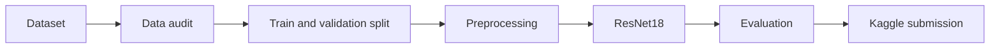

# ENGE707 — Facial Feature Classification

**ResNet18 · PyTorch · Kaggle · 2026 Semester 2**

An eight-class image classification project using transfer learning,
dataset auditing, reproducible preprocessing, validation and
controlled inference experiments.

## Project dashboard

| Metric | Recorded result |
|:--|--:|
| Labelled images | 63,660 |
| Kaggle test images | 29,443 |
| Full validation accuracy | **75.35%** |
| Macro F1-score | **70.53%** |
| Kaggle public score | **0.7420** |
| Observed leaderboard rank | **70** |

> Results describe the saved two-epoch ResNet18 baseline.
> Kaggle public scoring and local validation use different image sets.

## Project navigation

| Notebook | Contents |
|:--|:--|
| [01 — Dataset Analysis](notebooks/01_raw_data_analysis.ipynb) | Dataset structure, classes, image quality and audit |
| [02 — Preprocessing](notebooks/02_preprocessing.ipynb) | Image transforms, encoding and validation split |
| [03 — Baseline Model](notebooks/03_baseline_model.ipynb) | ResNet18 training, validation and saved results |
| [04 — Model Improvement](notebooks/04_model_improvement.ipynb) | Horizontal-flip test-time augmentation |
| [05 — Evaluation](notebooks/05_evaluation.ipynb) | Classification metrics and submission verification |


## Pipeline architecture




## Recorded baseline

| Setting | Value |
|:--|:--|
| Architecture | ImageNet-pretrained ResNet18 |
| Output classes | 8 |
| Input | RGB, 224 × 224 |
| Training device | CPU |
| Epochs | 2 |
| Batch size | 64 |
| Learning rate | 0.001 |
| Weight decay | 0.0001 |
| Random seed | 42 |
| Backbone weights | Gradient updates disabled |

The recorded run trained the replacement classification layer.
BatchNorm running statistics were not fully frozen; see the
[Codex review finding](https://github.com/diablez/Kaggle/pull/1).

## Inference experiment

Notebook 04 evaluated horizontal-flip test-time augmentation
on the same balanced 128-image validation subset.

| Method | Correct | Accuracy |
|:--|--:|--:|
| Standard inference | 93/128 | 72.66% |
| Horizontal-flip TTA | 93/128 | 72.66% |

**Measured difference: 0.00 percentage points.**

The TTA comparison does not represent full-validation performance.

## Reproduce the workflow

<details>
<summary><strong>1. Set up Python on Windows</strong></summary>

```powershell
py -3.13 -m venv .venv
.\.venv\Scripts\python.exe -m pip install --upgrade pip
.\.venv\Scripts\python.exe -m pip install -r requirements.txt
```

The recorded dependency versions are in `requirements-lock.txt`.

</details>

<details>
<summary><strong>2. Prepare the competition data</strong></summary>

```text
data/
  train_labels.csv
  sample_submission.csv
  train/
    train/
      *.jpg
  test/
    test/
      *.jpg
```

Download the dataset using authorised competition access.
Competition images are not included in this repository.

</details>

<details>
<summary><strong>3. Audit the dataset and test components</strong></summary>

```powershell
.\.venv\Scripts\python.exe scripts\audit_dataset.py
.\.venv\Scripts\python.exe -m pytest -q
```

Tests are included, but execution on an independent clean
environment has not been verified.

</details>

<details>
<summary><strong>4. Reproduce the baseline training configuration</strong></summary>

```powershell
.\.venv\Scripts\python.exe scripts\train.py --freeze-backbone --epochs 2 --batch-size 64 --learning-rate 0.001
```

The saved run used a duplicate-aware split informed by the
dataset audit. Different environments or input data may produce
different results.

</details>

<details>
<summary><strong>5. Generate Kaggle predictions</strong></summary>

```powershell
.\.venv\Scripts\python.exe scripts\predict.py
```

This requires the corresponding trained checkpoint under
`artifacts/baseline/`.

</details>

## Repository structure

```text
notebooks/          Five development and evaluation notebooks
src/enge707/        Reusable data, model and training modules
scripts/            Dataset audit, training and prediction
tests/              Pipeline component tests
docs/               Supporting documentation
requirements.txt    Installation dependencies
requirements-lock.txt
```

## Reproducibility boundaries

- Competition data and trained checkpoints are excluded from Git.
- Generated outputs are stored in the ignored `artifacts/` folder.
- The recorded experiment used Python 3.13.15 and CPU-only PyTorch.
- Saved metrics refer to the original experiment configuration.
- No independent clean-environment execution is claimed.
- Kaggle submission evidence and CSV are separate assessment artifacts.

The source, notebooks and commit history are preserved in this
repository.
